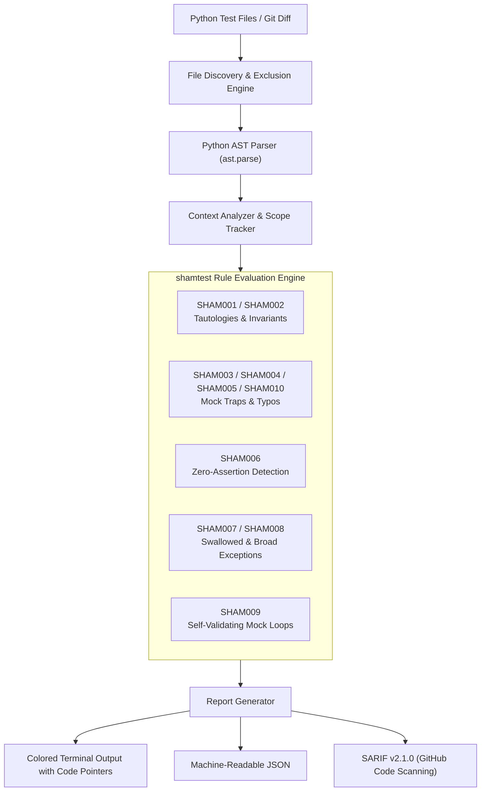

# shamtest

[](https://github.com/Nithinfgs/shamtest/actions/workflows/ci.yml)
[](https://opensource.org/licenses/MIT)
[](https://www.python.org/downloads/)
[](https://github.com/Nithinfgs/shamtest)

**Catch sham, tautological, and mock-poisoned tests before they merge.**

`shamtest` is a fast static analysis tool designed to inspect Python test suites for vacuous, tautological, unasserted, and mock-deceptive tests—patterns that commonly slip into codebases from AI coding agents (Claude Code, Cursor, Copilot, Codex) and fatigued pull request reviews.

---

## The Problem: The "Tests Pass" Illusion

With the rise of autonomous coding agents and automated PR generation, test suites are growing faster than ever. However, code coverage metrics often create a dangerous false sense of security:

```python
# ❌ The AI generated this test. It ran in CI, passed green, and increased coverage to 95%.
# But it tests absolutely nothing:
def test_user_billing():
    mock_service = Mock()
    mock_service.calculate_total.return_value = 100
    
    # Bug 1: Testing the mock against itself, not application code
    total = mock_service.calculate_total(items=[])
    assert total == 100

    # Bug 2: Missing parentheses () - never executed! Silently passes!
    mock_service.calculate_total.assert_called_once

    # Bug 3: In Python, bool(Mock()) is ALWAYS True, even if unconfigured!
    assert mock_service
```

Traditional linters (`flake8`, `ruff`) check syntax and formatting, but miss test semantics and mock traps. Traditional mutation testing (`mutmut`, `Cosmic Ray`) can take 30 to 60 minutes to mutate and re-run entire suites, making it impractical for pre-commit hooks or PR checks.

`shamtest` analyzes test AST structures in **under 10 milliseconds**, identifying sham patterns before code gets merged.

---

## Architecture Overview



---

## Key Features

- **Blazing Fast**: Scans 50+ test files in under 20 milliseconds using Python's native AST engine.
- **Zero Runtime Dependencies**: Built entirely with standard library modules (`ast`, `argparse`, `dataclasses`, `pathlib`, `typing`). No heavyweight compilers, no external dependencies.
- **Git Diff & Pre-Commit Ready**: Inspect only modified files or staged lines via `--diff`, `--staged`, or `--base main`.
- **Hollow Test Index**: Computes the exact proportion of low-signal / vacuous tests in your repository.
- **Multi-Format Reporting**: ANSI colored terminal diagnostic views with source pointers, machine-readable JSON, and GitHub Security SARIF output.
- **Fine-Grained Inline Suppressions**: Suppress false alarms using `# shamtest: disable=SHAM001` or standard `# noqa: shamtest`.

---

## Detection Rules Reference

| Rule ID | Severity | Name | Description & Example |
| :--- | :---: | :--- | :--- |
| **`SHAM001`** | **ERROR** | Tautological Assertion | Assertions that can never fail: `assert True`, `assert x == x`, `assert 1 == 1`, or `self.assertEqual(a, a)`. |
| **`SHAM002`** | **WARNING** | Trivially True Invariant | Checks that are always true by definition: `assert len(items) >= 0` or blind negative checks like `assert resp.status_code != 500`. |
| **`SHAM003`** | **ERROR** | Mock Truthiness Trap | Asserting `assert mock_obj`. In Python, `bool(Mock()) == True` always, passing even if the operation completely failed. |
| **`SHAM004`** | **ERROR** | Uncalled Mock Assertion | Calling a mock assertion without parentheses `()` (e.g. `mock.assert_called_once`). This merely accesses the method object and silently passes without asserting. |
| **`SHAM005`** | **ERROR** | Mock Method Typo | Calling misspelled methods on `Mock` (e.g. `mock.asser_called()`). Python's mock dynamically generates new mocks on access and never fails. |
| **`SHAM006`** | **ERROR** | Zero-Assertion Test | Test functions (`test_*`) that invoke code or mocks but contain zero assertions or expectation blocks. |
| **`SHAM007`** | **ERROR** | Swallowed Exception Block | Using `try: ... except: pass` in a test without verifying that an exception was actually raised. |
| **`SHAM008`** | **WARNING** | Overly Broad Exception Capture | Using `pytest.raises(Exception)` or `self.assertRaises(Exception)`, which masks severe bugs like `NameError`, `TypeError`, or bad imports. |
| **`SHAM009`** | **ERROR** | Self-Validating Mock Loop | Configuring a mock's `.return_value = 42` and then asserting that calling the mock returns `42`, testing `unittest.mock` rather than application code. |
| **`SHAM010`** | **ERROR** | Standalone Mock Property | Writing `mock.called` or `mock.call_count == 1` as a standalone expression statement without `assert`. |

---

## Installation

### From GitHub

```bash
pip install git+https://github.com/Nithinfgs/shamtest.git
```

### Local Development

```bash
git clone https://github.com/Nithinfgs/shamtest.git
cd shamtest
pip install -e .
```

---

## Quick-Start & Usage

### 1. Scan your tests directory

```bash
shamtest tests/
```

### 2. Scan only files modified in your git working tree

```bash
shamtest --diff
```

### 3. Pre-commit hook integration

Add to `.pre-commit-config.yaml`:

```yaml
repos:
  - repo: https://github.com/Nithinfgs/shamtest
    rev: v0.1.0
    hooks:
      - id: shamtest
        args: ["--staged"]
```

### 4. Fail CI on excessive hollow tests

Set a maximum threshold for the Hollow Test Index:

```bash
shamtest tests/ --max-hollow-index 10.0
```

### 5. Export SARIF for GitHub Code Scanning

```bash
shamtest tests/ --sarif > results.sarif
```

---

## Example Output

```text
shamtest — Automated Sham & Hollow Test Detection
================================================================

File: tests/test_payment.py
  [ERROR] 18:5 SHAM004 in test_payment_notification(): Uncalled mock assertion 'mock_mailer.assert_called_once'. Missing '()' parentheses. This attribute reference evaluates to a bound method and silently passes without executing an assertion.
    │ mock_mailer.assert_called_once
    │       ^
    ↳ Fix: Add parentheses: 'mock_mailer.assert_called_once()'.
  [ERROR] 24:5 SHAM003 in test_payment_gateway(): Truthiness assertion 'assert mock_gateway' on Mock object. In Python, bool(Mock()) is always True, so this assertion passes even if the function failed or returned an empty mock!
    │ assert mock_gateway
    │       ^
    ↳ Fix: Assert specific properties or call history: 'assert mock_gateway.called' or 'mock_gateway.assert_called_once()'.
  [ERROR] 31:1 SHAM006 in test_invoice_creation(): Test function 'test_invoice_creation()' executes code but contains ZERO assertions. This test will pass even if the code returns incorrect results or fails silently.
    │ def test_invoice_creation():
    ↳ Fix: Add explicit assertions on the return value, state change, or mock invocations.

----------------------------------------------------------------
Inspection Summary:
  Files Scanned:        1
  Total Tests:          3
  Hollow Tests:         3
  Hollow Test Index:    100.0% (proportion of low-signal / vacuous tests)
  Total Issues:         3 (3 errors, 0 warnings)
  Scan Duration:        1.8ms
```

---

## Configuration

Configure `shamtest` via `pyproject.toml` or `.shamtest.toml`:

```toml
[tool.shamtest]
# Ignore specific rules
ignore = ["SHAM002", "SHAM008"]

# Exclude directories
exclude = [
    ".venv",
    "tests/fixtures",
]

# Control severity gating ("ERROR" or "WARNING")
fail_on = "ERROR"

# Minimum severity to display
min_severity = "WARNING"

# Maximum allowable Hollow Test Index percentage
max_hollow_index = 5.0
```

---

## Running Tests

To run the full unit and integration test suite:

```bash
python3 -m unittest discover -s tests -p "test_*.py" -v
```

---

## Limitations

- `shamtest` focuses on Python test suites (`pytest`, `unittest`).
- Highly dynamic mock frameworks with customized `__getattr__` overrides that do not inherit from `unittest.mock.Mock` may require explicit suppression or custom rule configuration.
- Semantic vacuity involving domain-specific tautologies (e.g., custom database model identity checks) can be extended using custom rule definitions.

---

## Roadmap

- [ ] AST plugins for JavaScript/TypeScript test files (`jest`, `vitest`).
- [ ] Automated quick-fix CLI (`shamtest --fix`) to auto-append missing `()` to uninvoked mock assertions.
- [ ] Custom rule plugin system via Python entry points.
- [ ] Integration with VS Code and Cursor inline diagnostics.

---

## License

This project is licensed under the [MIT License](LICENSE).
